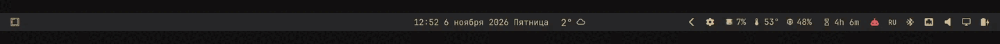

# Burn-in Guard

OLED burn-in protection for the Omarchy bar: every N seconds a dark wave sweeps
across the bar, shifting the static pixels (clock, metrics, icons) that would
otherwise burn in.

A panel plugin — nothing to place in the bar, no extra processes. The overlay
sits on the `overlay` layer exactly over the bar and lets every click through
(empty input mask).



## Install

```bash
omarchy plugin add https://github.com/vasko0z/omarchy-burnin-guard.git --enable --yes
```

Or from a local checkout:

```bash
git clone https://github.com/vasko0z/omarchy-burnin-guard.git \
  ~/.config/omarchy/plugins/vasko.burnin-guard
omarchy plugin enable vasko.burnin-guard
```

The shell hot-reloads local plugin changes, so editing the QML shows up at once.

## Remove

```bash
omarchy plugin disable vasko.burnin-guard
omarchy plugin remove vasko.burnin-guard --yes
rm -f ~/.config/omarchy/burnin-guard.json
```

Removing the plugin deletes the overlay; the bar is untouched.

## Settings

`~/.config/omarchy/burnin-guard.json` (optional, re-read on every change):

| Key | Default | Meaning |
|---|---|---|
| `intervalSeconds` | `60` | pause between waves (min 5) |
| `durationMs` | `1400` | how long one sweep takes (min 200) |
| `waveWidth` | `600` | wave width in logical px |
| `color` | `"#000000"` | wave color (any CSS/Qt color) |
| `opacity` | `1.0` | peak opacity, `0`–`1` |
| `height` | `26` | overlay height; keep equal to the bar thickness |

Example — a wide, half-transparent wave every 30 seconds:

```json
{
  "intervalSeconds": 30,
  "durationMs": 2200,
  "waveWidth": 900,
  "color": "#000000",
  "opacity": 0.55,
  "height": 26
}
```

Bar thickness comes from the theme (`Style.bar.sizeHorizontal`, 26 by default in
Omarchy). If you changed the bar size, set `height` to match.

## How it works

- One `PanelWindow` per screen, anchored to the top edge, `exclusionMode: Ignore`
  so it lands *over* the bar instead of below the bar's reserved strip.
- `mask: Region {}` — the surface takes no input; the bar stays fully clickable.
- The wave is a `Rectangle` with a horizontal transparent → color → transparent
  gradient; a `Timer` fires every `intervalSeconds` and restarts a
  `NumberAnimation` across the bar. Outside the sweep the rectangle is fully
  transparent, so there are no extra compositor frames.
- No state, no network, no dependencies beyond Quickshell (which Omarchy already
  runs).

## License

MIT
